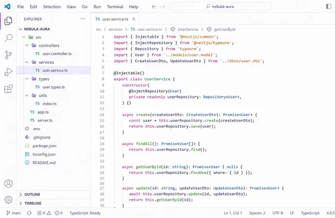
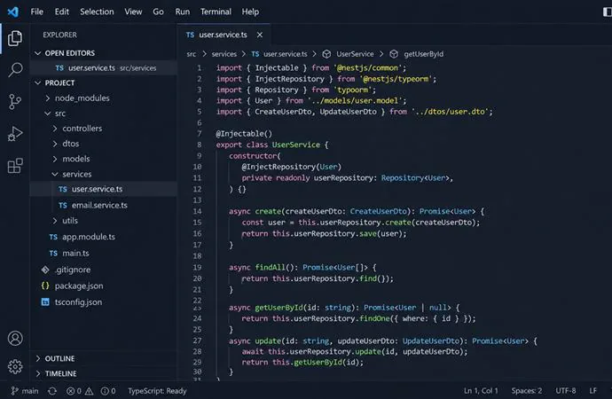
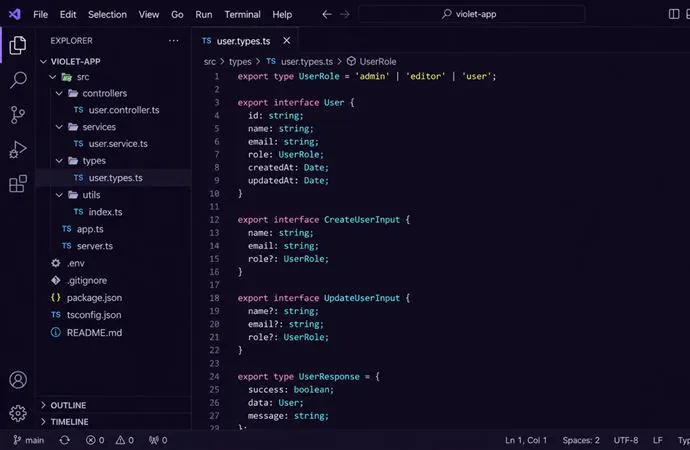

# Nebula Aura Theme

[](https://marketplace.visualstudio.com/items?itemName=nebula-themes.nebula-aura-theme)
[](https://marketplace.visualstudio.com/items?itemName=nebula-themes.nebula-aura-theme)
[](https://open-vsx.org/extension/nebula-themes/nebula-aura-theme)
[](https://open-vsx.org/extension/nebula-themes/nebula-aura-theme)
[](https://github.com/sponsors/luismpenholato)
[](LICENSE)

A modern light, dark, violet and midnight theme pack for VS Code, Cursor and Antigravity, inspired by Omni.

> More than 20,000 downloads across supported extension marketplaces.

## Install

[Install from Visual Studio Marketplace](https://marketplace.visualstudio.com/items?itemName=nebula-themes.nebula-aura-theme) ·
[Install from Open VSX](https://open-vsx.org/extension/nebula-themes/nebula-aura-theme)

After installing, open the Command Palette (`Ctrl+Shift+P`) and select:

```text
Preferences: Color Theme
```

Then choose any Nebula Aura theme.

## Previews

### Nebula Aura Light



### Nebula Aura Dark



### Nebula Aura Violet



### Nebula Aura Midnight


## Themes

Nebula Aura Theme includes four carefully crafted variants:

| Theme | Type | Style |
| --- | --- | --- |
| Nebula Aura Light | Light | Clean and soft |
| Nebula Aura Dark | Dark | Balanced and modern |
| Nebula Aura Violet | Dark | Purple-inspired |
| Nebula Aura Midnight | Dark | Deep night coding |

## Recommended for

- VS Code, Cursor and Antigravity
- Long coding sessions
- Frontend and backend development
- Cloud and data workflows
- Developers who prefer balanced contrast and consistent syntax highlighting

## Compatibility

| Editor | Support |
| --- | --- |
| [Visual Studio Code](https://code.visualstudio.com/) | Full |
| [Cursor](https://cursor.com/) | Full |
| [Antigravity](https://antigravity.google/) | Full |

## Install from VSIX

To install the extension locally, download the `.vsix` file from [GitHub Releases](https://github.com/luismpenholato/nebula-aura-theme/releases).

1. Open your editor.
2. Go to **Extensions**.
3. Open the actions menu (`...`).
4. Select **Install from VSIX...**
5. Choose the downloaded file.

### CLI

```bash
code --install-extension nebula-aura-theme-<version>.vsix
cursor --install-extension nebula-aura-theme-<version>.vsix
antigravity --install-extension nebula-aura-theme-<version>.vsix
```

## Changelog

See [CHANGELOG.md](CHANGELOG.md) for release history and notable changes.

## Development

1. Clone the repository:

   ```bash
   git clone https://github.com/luismpenholato/nebula-aura-theme.git
   cd nebula-aura-theme
   ```

2. Install dependencies:

   ```bash
   npm ci
   ```

3. Open the project in VS Code or Cursor.

4. Press `F5` to launch the Extension Development Host.

5. Open the Command Palette and select **Preferences: Color Theme**.

### Validation

Before submitting changes, run:

```bash
npm run themes:generate
npm run themes:validate
npm run list
npm run package
```

## Contributing

Contributions are welcome.

See [CONTRIBUTING.md](CONTRIBUTING.md) for local setup, validation commands and contribution guidelines.

For visual changes, include updated screenshots whenever applicable.

## Support the project

Nebula Aura Theme is free and open source (MIT).

If the theme improves your development experience, consider supporting continued maintenance through [GitHub Sponsors](https://github.com/sponsors/luismpenholato).

Sponsors fund this theme pack and **[Verdicspec](https://github.com/luismpenholato/verdicspec)** (specification-driven method for AI coding agents):

- theme improvements and editor compatibility;
- Verdicspec releases, skills and docs;
- issue triage and long-term open-source maintenance.

## Credits

Nebula Aura Theme is based on and inspired by [Omni for Visual Studio Code](https://github.com/getomni/visual-studio-code), originally created by Rocketseat and licensed under the MIT License.

This project is not affiliated with Rocketseat or the Omni Theme project.

See [NOTICE](NOTICE) for attribution details.

## Disclaimer

This project is not affiliated with Microsoft, Visual Studio Code, Cursor, Antigravity, Rocketseat or the Omni Theme project.

## License

Licensed under the [MIT License](LICENSE).
